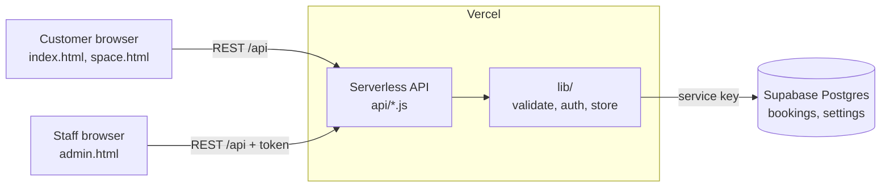

# Lumen Yard · Workspace Booking Platform.

A full-stack booking platform for a coworking space: a customer portal with an interactive floor plan, an admin dashboard for staff, and a REST API backed by Postgres.

> Concept project for a fictional company. Rates and availability are simulated.

## Features

**Customers**
- Interactive SVG floor plan (desks, private offices, meeting rooms, event space) with live availability
- Filters for quiet or social zones and morning sun
- Booking with date, time slot, drinks, seating and extras
- Instant guest Wi-Fi code and booking reference
- AI-style support chat, light and dark themes

**Staff (admin dashboard)**
- Password login with expiring sessions
- See, confirm, cancel and export every booking (CSV)
- Block spaces for maintenance
- Control the Power Hour discount (mode and percentage)

**Platform**
- Server-side validation and double-booking protection (API and database)
- Rate limiting, constant-time password check, signed session tokens
- Automated tests and CI on every push

## Architecture



| Layer | Where | Role |
|---|---|---|
| Front end | `index.html`, `space.html`, `admin.html`, `styles.css`, `data.js`, `api.js` | What people see and click |
| Back end | `api/`, `lib/` | Rules, security, saving data |
| Database | `db/schema.sql` | Source of truth, enforces one booking per space, date and slot |

## API

| Method | Route | Access | Purpose |
|---|---|---|---|
| GET | `/api/availability?date=` | public | Booked and blocked spaces, offer settings |
| POST | `/api/bookings` | public | Create a booking, returns ref and Wi-Fi code |
| POST | `/api/admin/login` | public | Password in, session token out |
| GET / PATCH / DELETE | `/api/admin/bookings` | admin | List, change status, delete |
| GET / PUT | `/api/admin/blocked` | admin | Spaces out of service |
| GET / PUT | `/api/admin/settings` | admin | Power Hour offer |

Admin routes need `Authorization: Bearer <token>`.

## Run locally

```bash
npm run dev     # http://localhost:3000, no install needed (Node 18+)
npm test        # run the automated tests
```
With no database configured it runs in demo mode: data lives in memory and the admin password is `admin2026`.

## Deploy (Vercel + Supabase)

1. Create a free project at supabase.com, open **SQL Editor** and run `db/schema.sql`.
2. In Supabase **Settings → API**, copy the project URL and the `service_role` key.
3. In Vercel **Settings → Environment Variables**, add the four values from `.env.example`.
4. Redeploy. Open `/admin.html` and sign in with your `ADMIN_PASSWORD`.

The `service_role` key is a server secret. It lives only in Vercel and is never put in front-end code or committed.

## Security notes

- Every input is validated again on the server; the browser is not trusted.
- Row Level Security is on with no public policies, so only the API can touch the data.
- Known limits: the rate limiter is in-memory, and the full-day versus slot clash check is application-level (the database enforces same-slot clashes). For production, add Supabase Auth for staff accounts and a shared rate-limit store.

## Roadmap

- Email confirmations (Resend or Postmark)
- Real guest Wi-Fi provisioning through the access controller
- Payments and invoices
- Multi-location support and staff roles
